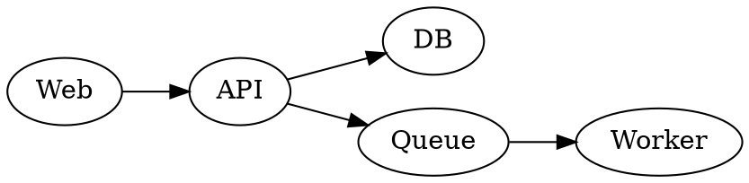
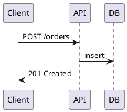
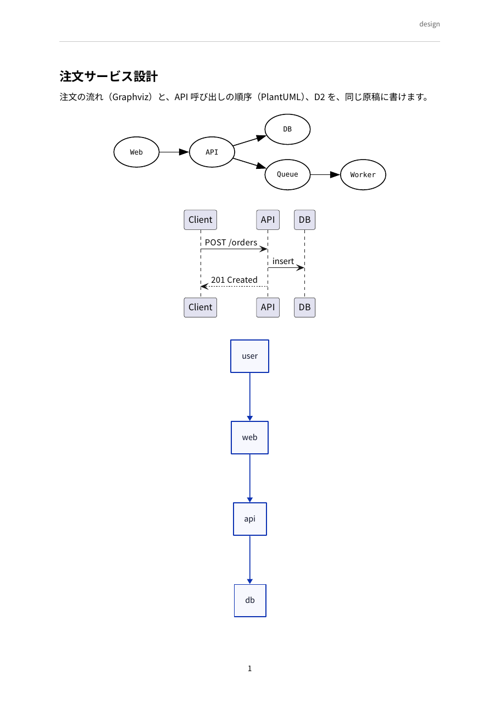
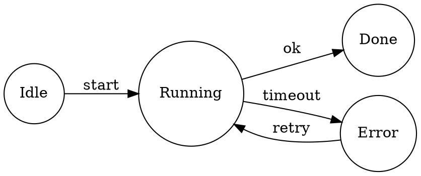
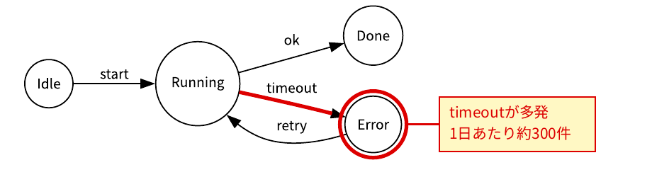

# text-compositor

*[English version (英語版)](README.md)*

text-compositorは、図入りの技術文書（設計書、アーキテクチャ資料など）を、Markdownで書いて、1冊のPDFにするツールです。Mermaid・PlantUML・D2・Graphvizなど、図の種類が違っても、同じ原稿の中に混ぜて書けます。図ごとにツールをインストールする必要はなく、必要なものは自動で取得してキャッシュします。同じ入力からは、同じPDFができます。手で書いた文書にも、AIが書いた下書きを人が直した原稿にも、使えます。

このREADMEは、最短で使い始めるための要点だけを載せています。`config.yaml`や原稿の書き方は[使い方ガイド](doc/usage/)（`cd doc/usage && python ../../build.py` でPDF化もできます）を、設計方針・実装状況は[doc/spec.md](doc/spec.md)を参照してください。

## ひと目で: 1つの原稿に、図を混ぜて書く

Markdownの中に、図のコードをそのまま書きます。Graphviz・PlantUML・D2・Mermaidなど、ツールが違っても、書き方は同じです。

````markdown
# 注文サービス設計





```d2
user -> web -> api -> db
```

| 項目 | 目標 |
| --- | --- |
| 応答時間 | 200ms以下 |
````

これを`text-compositor design.md`で変換すると、次のPDFになります（1ページ目）。



図ごとに、ツールをインストールしたり、画像を書き出して貼り直したりする必要はありません。上の例のGraphviz・PlantUML・D2は、追加の設定なしで動きます（必要なツールは自動で取得し、キャッシュします。PlantUMLはJavaを使います）。Mermaidなど、ブラウザで描く図だけは、[別途の準備](#mermaid図を使う場合任意)が要ります。表も、同じ原稿の中にそのまま書けます。ファイルを別々に分けて、1冊のPDFにまとめることもできます（[使い方](#使い方)）。

## 図に、SVGで注釈を重ねる

図の上に、SVGの図形や文字を重ねて、注目してほしい所を示せます。下の例は、状態遷移図の`timeout`の遷移を赤でなぞり、Error状態を囲んでいます。`::: layers`の中に、図のフェンスと、注釈の`svg`フェンスを順に書きます。後に書いたものが上になります。

````markdown
::: layers ジョブの状態遷移。Errorへのtimeout遷移が多発している


```svg
<svg xmlns="http://www.w3.org/2000/svg" width="470pt" height="132pt" viewBox="0 0 470 132" font-size="12">
  <g transform="translate(4 122.88)" fill="none" stroke="#d00" stroke-width="3">
    <path d="M173.79,-49.01C193.14,-44.84 218.12,-39.29 240.2,-33.88 243.02,-33.19 245.94,-32.46 248.86,-31.7"/>
    <circle cx="282.2" cy="-22.88" r="27"/>
  </g>
  <line x1="313" y1="100" x2="340" y2="100" stroke="#d00" stroke-width="2"/>
  <rect x="340" y="78" width="126" height="44" fill="#fff8c4" stroke="#d00"/>
  <text x="348" y="95" fill="#d00">timeoutが多発</text>
  <text x="348" y="112" fill="#d00">1日あたり約300件</text>
</svg>
```
:::
````



遷移をなぞる`path`の座標は、Graphvizが出すSVGの値です（上の例は、同じ値に`translate(4 122.88)`を足しています）。図を直して、ノードが動いたら、注釈の座標も直してください。Graphvizの図の大きさは、ptで決まります。注釈の`svg`にも、`width="470pt"`のように、ptで書くと、位置が合います（単位なしだと、px扱いで、1.33倍ずれます）。

## text-compositorの特徴

- 複数のテキストファイル（章）を1冊のPDFに結合
- Markdown → [markdown-it-py](https://github.com/executablebooks/markdown-it-py) でAST化 → [Typst](https://typst.app/) 構文へ決定論的に変換 → PDF出力
- その他のテキストファイル → そのままPDF出力
- ツール本体とドキュメント（原稿）を分離し、原稿はリポジトリ外の任意の場所に置ける
- Python中心・最小限のダウンロードで完結し、外部サーバーやSaaSに依存しない（GitHub Actions上でも、Windows/Linux/macOSのローカルでも同じ手順で動く）

`chapters`に列挙するファイルは、拡張子ごとに次のように扱われます。

- `.md`/`.markdown`: Markdownとして変換
- `.yaml`/`.yml`/`.json`: シンタックスハイライト付きの等幅表示
- `.dot`/`.gv`・`.mmd`・`.puml`/`.plantuml`/`.pu`・`.d2`・`.pikchr`・`.dsl`: それぞれGraphviz/Mermaid/PlantUML/D2/Pikchr/Structurizrの図として1章分描画（Structurizrは既定オフ。`plugins: { structurizr: true }`が要る。後述）
- `.csv`: Typstのテーブルとして構造化して描画
- `.cho`/`.chordpro`/`.pro`: ChordProのコード譜として描画（コードが歌詞の真上に並ぶ。` ```chordpro `フェンスと同じ）
- `.bizmodel`/`.bmv`: ビジネスモデル図（モノ・カネの流れ。`type canvas`でビジネスモデルキャンバス）として描画（` ```bizmodel `フェンスと同じ）
- それ以外（プレーンテキスト・コードファイル等）: 素の等幅表示

詳細は[使い方ガイド](doc/usage/)を参照してください。

## インストール

- Python 3.10以上

> **Windowsをお使いの方へ（重要）**: Microsoft Store版Pythonでは、このツールを使えません。`pipx`や`venv`を経由しても回避できません。
>
> 原因は、Store版Pythonが`%LOCALAPPDATA%`への書き込みをパッケージ専用の隔離フォルダへ透過的にリダイレクトすることにあります。このリダイレクトは、Store版Pythonから作った`venv`/`pipx`環境にも引き継がれます（実機で検証済み）。その結果、ファイルがPython自身には存在するように見えても、サブプロセス経由の機能（PlantUML、Mermaid、D2）が失敗します。
>
> このツールを使う前に、[python.org](https://www.python.org/downloads/)配布版など非Store版のPythonを別途インストールしてください（`winget install Python.Python.3.12`でも入手できます）。以降の手順は、そちらのPythonで実行してください。インストール後は`text-compositor --check-env`を実行すると、環境が正しく設定されているか確認できます。

インストール・実行方法は2通りあります。

### 方法A: `pip install`（推奨）

```bash
pipx install text-compositor
```

`pipx` はツールを隔離された環境にインストールし、`text-compositor` コマンドを使えるようにします（多くのユーザーにお勧めの方法）。このツール自体を開発する場合は、コードの変更を即座に反映できる `venv` + editable install（`pip install -e .`）を使ってください。

```bash
python -m venv .venv
.venv/bin/pip install -e .        # Windowsの場合: .venv\Scripts\pip install -e .
```

### 方法B: クローンして直接実行（インストール不要）

```bash
pip install -r requirements.txt
```

Typstコンパイラ本体はバイナリを同梱せず、上記の `pip install` で入る `typst` パッケージ（PyPIのホイール）から取得します。追加のダウンロードやインストールは不要です。

### 最新版を使う

セキュリティ修正やバグ修正は、新しい版として出します。自動更新はないため、最新版を使ってください。pipの場合は、`pipx upgrade text-compositor`（または`pip install -U text-compositor`）です。[Obunzu Markdown Viewer](viewer/README-ja.md)は、[Releasesのページ](https://github.com/tokudiro/text-compositor/releases/latest)から、最新のZIPを取得します。Viewerは、Pythonを同梱しているため、新しいZIPで、そのPythonと、ほかの同梱物も更新されます。Obunzuの使い方は、[Obunzu使い方ガイド](doc/obunzu-guide/)（Releasesに、PDFを添付しています）を参照してください。

## 使い方

`pip`/`pipx`でインストールした場合（方法A）:

```bash
text-compositor --config <path/to/text-compositor.config.yaml>
```

クローンして直接実行する場合（方法B）:

```bash
python build.py --config <path/to/text-compositor.config.yaml>
```

`--config` を省略した場合は、カレントディレクトリ直下の `text-compositor.config.yaml`（または `.json`）を自動的に探します。

```bash
cd my-project/
python /path/to/text-compositor/build.py
```

`text-compositor --check-env`（または `python build.py --check-env`）を実行すると、ビルドを実行せずに環境（依存関係・Typstのバージョン・キャッシュ済みアセット・Mermaid/PlantUML/D2の前提条件）を確認できます。

`config.yaml`なしで、1つのMarkdownを試しにPDFにするには、ファイルを直接指定します。`text-compositor note.md`は、同じフォルダに`note.pdf`を作ります。`-o OUTPUT`で出力先を、`-t TEMPLATE`でテンプレート（`template`・`slide`・`paper`、または`.typ`のパス）を指定できます。用紙・向きのオプションはありません。front-matterか`config.yaml`を使ってください。併用できないオプションは、使い方ガイドを参照してください。

`config.yaml`を使うビルドでは、その他のオプションは実行時の振る舞いのみを制御します（文書の内容は`config.yaml`に一本化する方針のため、出力先や用紙設定等の上書きオプションはありません）。`-q`/`--quiet`は`[Info]`レベルのログを抑制し、`-v`/`--verbose`は処理中の章・キャッシュ再利用状況などの詳細ログを追加表示します。`--keep-temp`は、ビルド成功時も中間ファイル`temp_build.typ`を削除せず残します（デバッグ用。失敗時は元々常に残ります）。

`--watch`を付けると、初回ビルド後も終了せず、config・入力ファイル・独自`.typ`テンプレートの保存を検知して自動で再ビルドします。ビルドが失敗しても止まらないため、修正して保存し直してください。`Ctrl+C`で終了します。プロジェクトディレクトリの外にあるファイル（`../`で参照する画像など）の変更は検知しません。

`--if-changed`を付けると、出力PDFがconfig・入力ファイル・テンプレート・text-compositor本体のいずれよりも新しい場合に、makeのようにビルドをスキップします（判定は更新日時のみ）。付けなければ従来どおり毎回再生成します。Typstのバージョン、プロジェクトディレクトリの外のファイル、`variables`が参照する環境変数の変更は検知しません。CIでは`actions/checkout`が全ファイルの更新日時を更新するため、スキップを効かせるには出力先をキャッシュから復元してください。

`--clean`は、ビルドせずに出力PDFと`.text-compositor/`直下の中間ファイル（`temp_build.typ`・`_template.typ`・`_common.typ`）を削除します。`--clean-cache`は、加えて図表キャッシュ（`.text-compositor/cache/`）も削除します。入力ファイルとconfigは削除しません。

### Python API

`text_compositor.Session`と`build_markdown()`で、`config.yaml`なしに、単一のMarkdownをPDFにできます。警告とエラーは、標準出力へ出さず、構造化した診断（Markdownのファイル・行つき）として返します。GUIのビューアなどからは、常駐ワーカー（`python -m text_compositor.worker`）を、標準入出力のJSON行で使えます。使い方ガイドの「Pythonから使う」と、[doc/spec.md](doc/spec.md)の14章を参照してください。

```python
from text_compositor import Session

with Session() as session:  # ビルドをまたいで、Mermaidのブラウザ・Typstコンパイラを使い回す
    result = session.build("doc.md", "out/doc.pdf")
    print(result.ok, result.pdf_path, [d.message for d in result.diagnostics])
```

`session.render_html("doc.md")`（実験的。[#161](https://github.com/tokudiro/text-compositor/issues/161)）は、PDFの代わりに、1ファイルで完結したHTMLを出力します。図（Mermaid・PlantUML・D2・Structurizr・Graphviz・Pikchr・CeTZ・Fletcher・timeliney・finite・Vega-Lite・Vega・WaveDrom・Bytefield・`svg`）は、隣に画像として出します。`typst-exec`・生のHTMLは、まだ未対応で、警告つきでコードとして表示します。Graphviz・Pikchr・CeTZ・Fletcher・timelineyは、PDFと同じく、Typstのパッケージ（`diagraph`・`kip`・`cetz`・`fletcher`・`timeliney`）で図になります（Graphvizの`shape=record`・図全体の`label`は、描けないため、警告します）。

設定ファイルの書き方は [sample/text-compositor.config.yaml](sample/text-compositor.config.yaml) を、`document:`/`plugins:`/front-matter/Marpディレクティブ等の詳しい説明は[使い方ガイド](doc/usage/)を参照してください。`chapters` に列挙したMarkdownファイルを順に結合してPDFを生成します。

## サンプルを試す

```bash
cd sample/
python ../build.py
```

`sample/SampleDocument.pdf` が生成されます。ほかのテンプレートを示すサンプルが2つあります。`sample/paper/`（2段組みの論文形式、`template.path: paper`）と、`sample/universe-ilm/`（[Typst Universe](https://typst.app/universe)のテンプレートをアダプタ経由で使う例。初回のビルドはネットワークが必要）です。

arc42の章立て（12章）とC4モデルの図で書いた、アーキテクチャ設計書の例は、`sample/c4-structurizr/`です。架空のECサイトを題材に、目標と品質目標（ASR）、制約、C4の5つの図（System Context・Container・Component・Dynamic・Deployment）、実行時のシナリオ、設計判断（ADR）、リスク、用語集までを書き、改版履歴と用語索引も付けています。1つのモデル（`model.dsl`）を、すべての図が`!include`で共有します。モデルを直すと、すべての図に反映されます（`text-compositor --config sample/c4-structurizr/text-compositor.config.yaml`。Structurizrを使うため、初回は、Javaと`structurizr-cli`（約99MB）の取得が要ります）。

同じ文書を、PlantUML（C4-PlantUML）で書いた例は、`sample/c4-plantuml/`です。追加の取得は要りません（`text-compositor --config sample/c4-plantuml/text-compositor.config.yaml`）。

架空ではなく、実在のシステムを題材にした例として、`sample/arc42-text-compositor/`があります。text-compositor自身（Obunzuを含む）を、arc42の12章とC4-PlantUMLで書いた設計書です。制約・品質目標・決定（ADR）の各項目に、根拠になったリポジトリの記録（README・`doc/`・issue番号）を示し、確認できなかったことは「未確認」と書いています。追加の取得は要りません（`text-compositor --config sample/arc42-text-compositor/text-compositor.config.yaml`）。

## 図の種類ごとの準備（任意）

Mermaidは、ブラウザが要ります。PlantUMLとD2は、追加の設定なしで使えます（足りないものは自動で取得します）。使う図の種類の分だけ、読んでください。

### Mermaid図を使う場合（任意）

原稿の中で ` ```mermaid ` フェンスを使う場合（または`.mmd`ファイルを`chapters`に直接指定する場合）のみ必要です。方法Aの場合は`mermaid`エクストラを追加でインストールします。

```bash
pipx install "text-compositor[mermaid]"
# 既にインストール済みの場合: pipx inject text-compositor playwright==1.63.0
```

方法B（クローンして直接実行）の場合:

```bash
pip install playwright==1.63.0
```

- **システムにインストール済みのGoogle ChromeまたはMicrosoft Edge**（既定では新規ダウンロードしない。ビルド時に自動検出して再利用する）
- 上記の `playwright` パッケージ（既存ブラウザへCDP接続するために使うだけで、既定ではPlaywright自身のブラウザダウンロード機能は使わない）

Node.js/npmは不要です。ビルド時にMermaid公式配布の単一バンドルJS（`mermaid.min.js`、約5.5MB）を取得してヘッドレスブラウザに読み込ませ、SVGに変換します（バンドルJS自体はOS標準のユーザーキャッシュディレクトリ、例えばWindowsなら`%LOCALAPPDATA%\text-compositor\Cache`、Linuxなら`~/.cache/text-compositor`にキャッシュし、変換結果は `.text-compositor/cache/` にキャッシュされ、次回以降は再取得しません）。Mermaidを使わない原稿ではこれらは一切不要です。

システムにChrome/Edgeが無い場合は既定でエラー終了します。`plugins: { mermaid_auto_download: true }` にすると代わりにPlaywright自身のChromiumを自動取得します。ただし、**このダウンロードは約700MBあります**（プレインストールされたブラウザを使わない場合の最後の手段として用意した設定です。既定でこの量をダウンロードしてしまうことは意図的に避けています）。

### PlantUML図を使う場合（任意）

原稿の中で ` ```plantuml ` フェンスを使う場合（または`.puml`ファイルを`chapters`に直接指定する場合）、`config.yaml`側の追加設定は不要です（`plugins.plantuml`は既定`true`。追加の`pip install`も不要）。

- ローカルにJava（11以上）があればそのまま再利用します
- 無ければ既定でEclipse Temurin JRE（Adoptium配布、約49.7MB）を上記と同じユーザーキャッシュディレクトリへ自動取得・キャッシュします。`plugins: { plantuml_auto_download: false }` にすると、自動取得せずエラー終了に変えられます
- GitHub Actionsの`ubuntu-latest`にはJavaが標準搭載されているため、CI上では追加ダウンロードは発生しません

レイアウトエンジンには純Java実装の Smetana を使うため、Graphviz（`dot`）等の外部バイナリは不要です。PlantUML本体（MIT版、約17.6MB）は同じユーザーキャッシュディレクトリに、変換結果はMermaidと同じく `.text-compositor/cache/` にキャッシュされます。

PlantUMLのスプライト記法も使えます。独自の`sprite`定義に加え、jarへ同梱されたアイコンライブラリ（`aws`/`awslib14`・`azure`・`gcp`・`k8s`・`office`・`archimate`・`tupadr3`ほか約30種）も利用できます。これらのstdlibはplantuml.jar自体に含まれるため、ネットワークアクセスなしで描画できます（`!include <office/Servers/database_server>`と`!include <tupadr3/common>`を組み合わせた例で、出力SVGへPNGアイコンがインライン埋め込みされることを確認済みです）。一部のライブラリ（`office`・`awslib14`等）は、マクロ呼び出し（`OFF_DATABASE_SERVER(id, "label")`等）のために`tupadr3/common`の併記が要ります。ライブラリの一覧と正確なマクロ名は、[PlantUML公式のstdlibドキュメント](https://plantuml.com/stdlib)を参照してください。

### D2図を使う場合（任意）

原稿の中で ` ```d2 ` フェンスを使う場合（または`.d2`ファイルを`chapters`に直接指定する場合）、`config.yaml`側の追加設定は不要です（`plugins.d2`は既定`true`。追加の`pip install`も不要）。

- ローカルに`d2`コマンドがあればそのまま再利用します
- 無ければ既定でD2公式CLIバイナリ（Go製の単一実行ファイル、約13MB）を上記と同じユーザーキャッシュディレクトリへ自動取得・キャッシュします。`plugins: { d2_auto_download: false }` にすると、自動取得せずエラー終了に変えられます

Java（PlantUMLが使う）やブラウザ（Mermaidが使う）と異なり、GitHub Actionsの`ubuntu-latest`にはD2が標準搭載されていないため、`d2`図を使うとCI実行のたびにこの約13MBのダウンロードが発生します（このプロジェクトのワークフローは、実行間でキャッシュディレクトリを永続化していません）。

### Structurizr図（C4モデル）を使う場合（任意・既定オフ）

Mermaid/PlantUML/D2と異なり、`plugins.structurizr`は既定`false`です。` ```structurizr ` フェンス（または`.dsl`ファイルを`chapters`に直接指定する場合）を使うには、`plugins: { structurizr: true }`と明示してください。既定でオフなのは、内部で使う公式`structurizr-cli`が約99MBあるためです（他のプラグインは13〜18MB）。この大きさの大半はKotlin/JRuby/Groovyのスクリプト機能（本ツールでは使わない）が占めており、代わりに使える軽量な公式配布物はありません。

内部では、DSLを`structurizr-cli`でPlantUMLへ書き出し、上記と同じPlantUML/Smetanaのパイプラインで描画します（新しい描画エンジンは持ちません）。PlantUMLと同じくJavaが必要で、`plugins.plantuml_auto_download`とは独立した`plugins.structurizr_auto_download`（既定`true`）で制御します。

1つのワークスペースが定義できるビューは、フェンス1つにつき1つに限ります。`structurizr-cli`には、複数ビューから1つだけ選ぶオプションが無いため、黙ってどれかを選ぶ代わりにエラーで終了します。複数のビューが必要な場合は、フェンスを分け、共通のモデルはDSLの`!include`で共有してください。

## Obunzu Markdown Viewer

このリポジトリには、**Obunzu Markdown Viewer**（略称はObunzu）も入っています。Markdownと図を表示する、軽量な、閲覧専用のViewerです。text-compositorと、同じ変換の仕組みの上に作っています。

- Markdownのファイルと、図の単体ファイル（Mermaid・PlantUML・D2・Graphviz・Vega-Lite・SVGなど）を、専用のウィンドウで開き、絵にして表示します。
- ファイルを保存すると、表示が更新されます。お使いのエディタで書きながら、Obunzuで見た目を確かめられます。変換に失敗したときは、原稿の何行目で問題が起きたかを示します。
- Windows（64ビット）向けの、ポータブルなZIPで配布します。Pythonと図のツールを同梱しているため、先にインストールするものはありません。[Releasesのページ](https://github.com/tokudiro/text-compositor/releases/latest)から、ダウンロードしてください。
- 文書の編集と、PDFの出力は、できません。PDFが必要なときは、text-compositorを使ってください。

開発する人向けの情報は[viewer/README-ja.md](viewer/README-ja.md)に、使う人向けの説明は[Obunzuの説明書](doc/obunzu-guide/)にあります。

## ほかのツールとの違い

同じ図の変換は、pandocやTypstを直接使っても、原理的にできます。text-compositorが新しい変換能力を持つわけではありません。text-compositorがしているのは、Mermaid・PlantUML・D2などのツールごとの環境構築（依存ツールのインストール、キャッシュ管理、CI対応）を、`config.yaml`ひとつにまとめることと、複数の人（AIを含む）が持ち寄ったテキストを、安全に1冊にまとめるための決まりを、ツールに組み込むことです。Typst自体との違い、Quarto等の汎用ツールとの違いは、[doc/diff-ja.md](doc/diff-ja.md)にまとめています。

## 実装状況

現在実装されているのは「`--config` で指定した（または自動検出した）設定ファイルに従い、複数のファイルを1つのPDFへ結合する」というコア機能です。単一のMarkdownは、configなしでもPDFにできます（`FILE.md`・`-o`・`-t`）。ほかのCLIオプションの拡張（複数のファイルやフォルダの直接指定など）は構想段階です。既知の課題・今後の予定は [GitHub Issues](https://github.com/tokudiro/text-compositor/issues) を参照してください。

## 記法（図のツール）を追加する方針

このツールは、商用利用が無償で、ローカルで動作し、利用者に制約を課しません（[doc/spec.md](doc/spec.md)の2章）。そのため、次のいずれかにあたる図のツール・記法は、**追加しません**。

- **強いライセンスの制約があるもの。** GPL・AGPLなどの強いコピーレフト、出力に残さなければならない透かし・クレジット、有償、利用回数などの制限。
- **動作環境が重いもの。** Dockerなどのコンテナ、または、多くの利用者が持っていない大きな実行環境が必要なもの。
- **外部のサービスを使うもの。** 原稿をサーバーへ送信するもの。

これらにあたる候補は、理由を記録して、[GitHub Issues](https://github.com/tokudiro/text-compositor/issues)で、not plannedとしてクローズします。

## ライセンス

[MIT License](LICENSE)
