# PlantUMLのギャラリー

`plantuml`が対応する図の種類の実例です（[#291の対応表](29_diagram_matrix.md#記法で描ける図の種類対応表)）。記法の説明は「図表」の章の「PlantUML固有の注意点」を参照してください。

## シーケンス図

::: layout-left {left=55 right=45}
````text
@startuml
利用者 -> 画面 : ログイン操作
画面 -> API : 認証リクエスト
API -> DB : ユーザー照会
DB --> API : ユーザー情報
API --> 画面 : トークン発行
画面 --> 利用者 : ログイン完了
@enduml
````

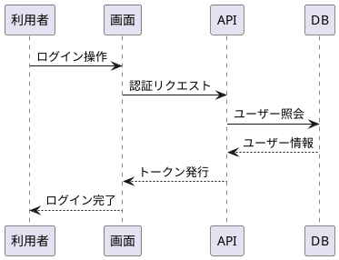
:::

## タイミング図

::: layout-left {left=55 right=45}
````text
@startuml
robust "画面" as 画面
robust "API" as API

画面 is 待機中
API is 待機中

@0
画面 is 待機中
@100
画面 is 送信中
API is 処理中
@300
画面 is 待機中
API is 待機中
@enduml
````

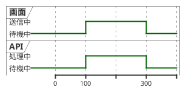
:::

## クラス図

::: layout-left {left=55 right=45}
````text
@startuml
class 注文 {
  +id: int
  +注文日: Date
  +合計金額(): int
}
class 明細 {
  +数量: int
  +単価: int
}
注文 "1" --> "*" 明細
@enduml
````

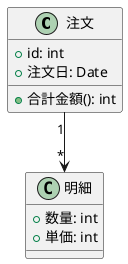
:::

## 状態遷移図

::: layout-left {left=55 right=45}
````text
@startuml
[*] --> 受付中
受付中 --> 審査中 : 提出
審査中 --> 承認済み : OK
審査中 --> 差し戻し中 : NG
差し戻し中 --> 受付中 : 再提出
承認済み --> [*]
@enduml
````

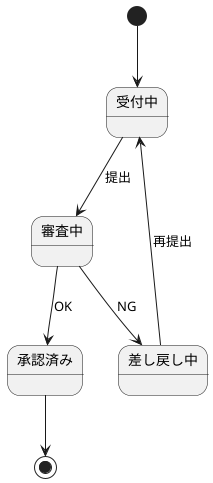
:::

## ユースケース図

::: layout-left {left=55 right=45}
````text
@startuml
left to right direction
actor 利用者
actor 管理者
利用者 --> (商品を注文する)
利用者 --> (注文を照会する)
管理者 --> (在庫を管理する)
@enduml
````

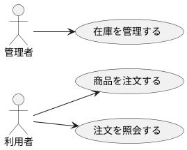
:::

## アクティビティ図

::: layout-left {left=55 right=45}
````text
@startuml
start
:注文を受け付ける;
if (在庫あり?) then (はい)
  :出荷準備をする;
else (いいえ)
  :取り寄せる;
endif
:発送する;
stop
@enduml
````

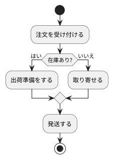
:::

## コンポーネント図／配置図

::: layout-left {left=55 right=45}
````text
@startuml
node "Webサーバー" {
  component "Webアプリ" as WebApp
}
node "APIサーバー" {
  component "API" as API
}
node "DBサーバー" {
  database "データベース" as DB
}
WebApp --> API
API --> DB
@enduml
````

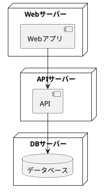
:::

## オブジェクト図

::: layout-left {left=55 right=45}
````text
@startuml
object 注文1 {
  id = 1001
  合計金額 = 3200
}
object 明細A {
  数量 = 2
  単価 = 1600
}
注文1 --> 明細A
@enduml
````

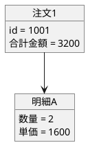
:::

## パッケージ図

::: layout-left {left=55 right=45}
````text
@startuml
package "注文管理" {
  class 注文コントローラー
  class 注文サービス
}
package "在庫管理" {
  class 在庫サービス
}
注文管理 --> 在庫管理
@enduml
````

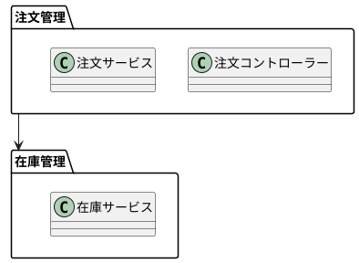
:::

## ガントチャート

::: layout-left {left=55 right=45}
````text
@startgantt
Project starts 2026-04-01

[要件整理] requires 5 days
[画面設計] requires 8 days
[バックエンド実装] requires 15 days
[フロントエンド実装] requires 12 days

[画面設計] starts at [要件整理]'s end
[バックエンド実装] starts at [画面設計]'s end
[フロントエンド実装] starts at [画面設計]'s end

[リリース] happens at [バックエンド実装]'s end
@endgantt
````

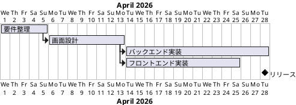
:::

## マインドマップ

::: layout-left {left=55 right=45}
````text
@startmindmap
* ECサイト刷新
** 設計
*** 画面設計
*** API設計
** 実装
*** バックエンド
*** フロントエンド
** 運用
*** 監視
*** 障害対応
@endmindmap
````

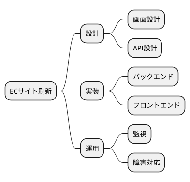
:::
