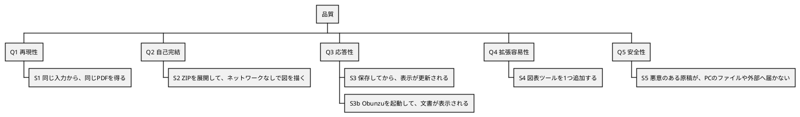

# 10 品質要求

1.5の品質目標を、測れる形に直す。評価のシナリオごとに、目標値と、測り方を書く。目標値は、リポジトリの文書にあるものだけを使う。現状は、10.3に書く。記録が無いものは、「未確認」と書く。

## 10.1 品質ツリー

<!-- pagebreak -->

## 10.2 評価のシナリオ

| ID | 品質 | 状況（刺激） | 期待する応答 | 目標値 | 測り方 |
| --- | --- | --- | --- | --- | --- |
| S1 | Q1 | 同じ原稿と設定で、別の日・別のPCで、ビルドする | 同じ見た目のPDFを得る | 依存の版が、固定した値と一致する。全ページ画像が一致する | `tests/test_bundled_*.py`・`--check-env`・版の更新前後の画像比較 |
| S2 | Q2 | ZIPを展開し、Pythonへの手がかりと、ネットワークを遮断して、図を含む文書を開く | 追加の取得なしに、図が表示される | 初回起動時の追加ダウンロード: 0。`check-dist.js`の54項目が通る | `check-dist.js`（手元） |
| S3 | Q3 | 図のキャッシュが命中する文書を、保存する | 表示が、更新される | 保存から表示の更新まで、300 ms以内（デバウンス込み。#170の案） | `benchmarks/api_latency.py`・`check-auto-reload.js` |
| S3b | Q3 | Obunzuを起動する | 文書が表示される | 起動から表示まで、1秒以内（#180の基準） | `check-dist.js`（プロセスの開始から、文書の表示まで） |
| S4 | Q4 | 図表ツールを1つ追加する | 手で同期する場所が、少ない | 同期する場所を、1か所に近づける（#474の目標） | `tests/test_renderer_options.py`・設計書`doc/plugin-architecture.md`2章の表 |
| S5 | Q5 | 原稿の`!include`が、プロジェクトの外のファイルやURLを指す。原稿に外部の画像のURLがある | 読まれず、理由つきのエラーになる。画像は、読み込まれない | 外へ出る通信: 0。外のファイルの読み取り: 0 | `tests/test_plantuml_security.py`・`tests/test_plantuml_include.py`・Viewerのテスト |

<!-- pagebreak -->

## 10.3 シナリオの現状

各シナリオが、いま、どこまで確かめられているかを書く。値は、リポジトリの文書にある記録で、この文書のために測り直したものではない。

| ID | 現状と根拠 |
| --- | --- |
| S1 | 版は固定済み（8.1）。Pikchrの載せ替えで、ギャラリーのPDFが、画素まで一致した。バイト一致は、未確認 |
| S2 | 同梱済み。Typst関連は、遮断したネットワークで確認。別PC（Pythonをアンインストール済み）で、v0.3.8のMermaidの表示を確認（2026-09-21。それ以外の機能は、記録なし） |
| S3 | ワーカー側は、35〜62 ms（Windows 11）。Electron上で、300 msを測り直した記録は、未確認 |
| S3b | 5回で、0.82〜0.90秒（2026-09-19、開発機） |
| S4 | 設計書の調査では、`renderer_diagrams.py`・`renderer.py`・`project.py`・`api.py`・`config.py`・`env_check.py`・`host_renderers.py`・`worker.py`・`deps.py`の9か所を、手で同期していた。`renderer_options.py`の表（#488）で、そのうち、設定の部分は、1行になった。残りの状態は、未確認 |
| S5 | 実機で、LEGACYでは読めること、ALLOWLISTで拒否されることを、確認した |

## 10.4 その他の品質

| 品質 | 目標値と測り方 | 現状 |
| --- | --- | --- |
| Obunzuのアクセシビリティ | axe-coreで、serious以上の違反なし。NVDAでの手動確認（`check-a11y.js`・`doc/viewer-accessibility.md`） | 2026-10-02の調査で、serious 3件（`lang`・コントラスト比のライトとダーク）が挙がった。対応後の再測定は、未確認 |
| PDFのアクセシビリティ | PDF/UAタグ・読み上げ順序・alt | 未着手（[#319](https://github.com/tokudiro/text-compositor/issues/319)） |
| 配布物の大きさ | ZIP 約297.8 MB、展開後 約698.3 MB | 許容する。削減は、行わない（ADR-6） |
