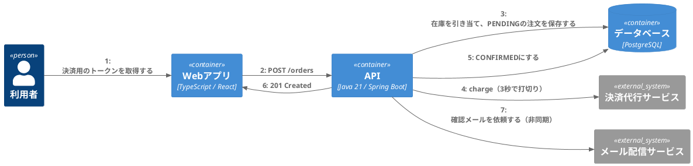
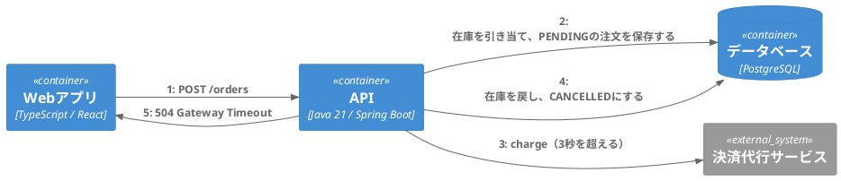
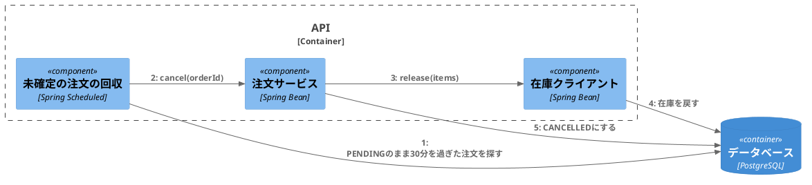
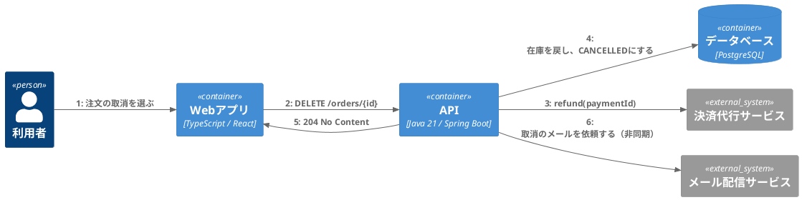
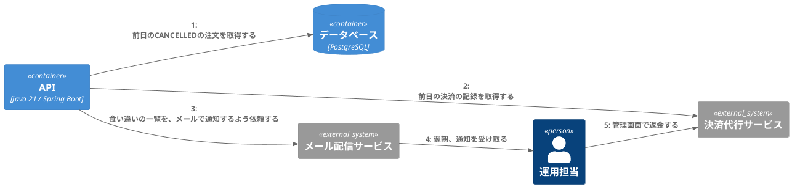
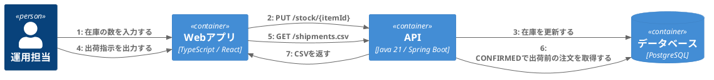

# 6 実行時の見方

構造に影響が大きい6つのシナリオを示す。選んだ基準は、アーキテクチャ上の重要さである。

| 節 | シナリオ | 選んだ理由 |
| --- | --- | --- |
| 6.1 | 注文を確定する | 最も重要な機能（F2）。注文・在庫・決済・メールの、すべての構成要素が関わる |
| 6.2 | 決済が打ち切られる | 外部との重要な接点（[[決済代行サービス]]）での失敗。ADR-2の動き |
| 6.3 | 障害で処理が止まった場合 | 障害からの自動回復（S2）。人の対応なしで、整合を保つ |
| 6.4 | 注文を取り消す | 決済の返金（`refund`）が関わる、もう1つの決済の流れ（F3） |
| 6.5 | 夜間の[[照合]] | [[打切り]]の後始末（ADR-2）。[[運用担当]]が関わる |
| 6.6 | 運用担当の在庫更新と[[出荷指示]] | 運用担当の機能（F4・F5）。[[利用者]]とは別のロールの流れ（8.1） |

書かなかったシナリオと、その理由は、次のとおり。

- ログインとトークンの更新: 他のシナリオと、同じ構造（Webアプリ → API → データベース）である。決まりは、8.1に書いた。
- 商品の閲覧と、注文履歴の確認（F1・F3の閲覧）: 画面からAPIを1回呼び、データベースを読むだけで、6.1と同じ構造の部分集合である。
- コンテナの停止と自動置換: 配置の話が中心のため、7章に書く。

<!-- pagebreak -->

## 6.1 注文を確定する

**前提**: 認証済みの利用者が、カートの商品を注文する。決済代行サービスは、正常に応答する。

| 図の番号 | 内容 | 時間の目安 |
| --- | --- | --- |
| 1 | 利用者が、決済代行サービスの画面でカード情報を入力し、決済用のトークンを受け取る（ADR-4） | （利用者の操作） |
| 2 | Webアプリが、`POST /orders`を呼ぶ（商品・数量・トークン・配送先） | 通信を含めて100ms |
| 3 | APIが、認証と入力を検証する（8.1、5.3）。注文サービスが、在庫を引き当て、`PENDING`の注文を、同じトランザクションで保存する（ADR-3） | 60ms |
| 4 | 決済クライアントが、決済代行サービスへ、決済を依頼する（HTTPS） | 通常800ms（上限3秒） |
| 5 | 注文を`CONFIRMED`にして、[[決済ID]]を保存する | 20ms |
| 6 | `201 Created`と注文IDを返す | |
| 7 | 確認メールの送信を、非同期で依頼する。手順6の応答を、待たせない（8.3） | |

手順2〜6の合計は、約1秒。10章のS1の目標値（95パーセンタイルで2秒以内）に対し、余裕がある。余裕は、決済代行サービスの応答のばらつきに、割り当てている。

<!-- pagebreak -->

## 6.2 決済が打ち切られる

**前提**: 6.1と同じ。ただし、決済代行サービスが、3秒以内に応答しない。

| 図の番号 | 内容 | 時間の目安 |
| --- | --- | --- |
| 1・2 | 6.1の手順2・3と同じ | 約160ms |
| 3 | 決済クライアントが、3秒で打ち切り、`PaymentTimeout`を返す。再試行しない（ADR-2） | 3秒 |
| 4 | 注文サービスが、`release(items)`で在庫を戻し、注文を`CANCELLED`にする（5.5） | 70ms |
| 5 | `504`を返す。画面は、「決済を確認できませんでした。時間をおいて、もう一度お試しください」と表示する | |

合計は、約3.3秒。10章のS1の上限（3.5秒以内に失敗を返す）に収まる。

**打切り後の後始末**: 決済代行サービスの側では、決済が成功している場合がある。6.5の照合で、見つける。

<!-- pagebreak -->

## 6.3 障害で処理が止まった場合

**前提**: 6.1の手順3〜5の間に、APIのコンテナが停止し、`PENDING`の注文が、残っている。

| 図の番号 | 内容 |
| --- | --- |
| 1 | 起動時と、5分ごとに、`PENDING`のまま、30分を過ぎた注文を探す |
| 2・3・4 | 見つけた注文ごとに、`cancel`を呼び、在庫を戻す |
| 5 | 注文を`CANCELLED`にする |

- 30分の猶予は、APIの再起動と、決済の最大待ち時間（3秒）に、十分な余裕を持たせた値である。
- 決済が成功していた注文は、`CANCELLED`のまま残る。6.5の照合で、見つける。
- 10章のS2の目標（未確定の注文は、30分以内に取り消す。在庫の不整合は0件）に、対応する。

<!-- pagebreak -->

## 6.4 注文を取り消す

**前提**: 利用者が、確定した注文（`CONFIRMED`）で、出荷前のものを、取り消す。

| 図の番号 | 内容 |
| --- | --- |
| 1・2 | 利用者が、取消を選ぶ。Webアプリが、`DELETE /orders/{id}`を呼ぶ |
| 3 | 決済クライアントが、`refund(paymentId)`で、返金を依頼する。取消済みなら、何もしない（5.6） |
| 4 | 在庫を戻し、注文を`CANCELLED`にする |
| 5・6 | `204`を返す。取消のメールを、非同期で依頼する |

- 出荷済みの注文は、取り消せない（`409`。5.3）。
- 返金が失敗したときは、注文を`CONFIRMED`のままにして、`502`を返す。利用者は、再度、取消を試せる。

<!-- pagebreak -->

## 6.5 夜間の照合

**前提**: 毎日、午前3時に、前日の注文を、決済代行サービスの記録と照合する。

| 図の番号 | 内容 |
| --- | --- |
| 1・2 | 前日に`CANCELLED`になった注文と、決済代行サービスの決済の記録を、取得して、突き合わせる |
| 3・4 | 注文は取り消されているのに、決済が成功している組を、一覧にして、運用担当に、メールで通知する |
| 5 | 運用担当が、決済代行サービスの管理画面で、返金する |

- 食い違いが0件のときは、通知しない。
- 照合の実行に失敗したときは、運用担当に通知する（8.3）。夜間は、人が対応しない（OC4）ため、翌朝に対応する。

<!-- pagebreak -->

## 6.6 運用担当の在庫更新と出荷指示

**前提**: 運用担当が、二要素認証でログインしている（8.1）。ロールは`OPERATOR`。

| 図の番号 | 内容 |
| --- | --- |
| 1〜3 | 在庫の数を入力し、`PUT /stock/{itemId}`で、`stock`の`qty`を更新する。`CUSTOMER`のロールでは、`403`になる（8.1） |
| 4〜7 | 出荷指示を出力する。`CONFIRMED`で出荷前の注文を取得し、CSVにして返す。物流倉庫との連携は、CSVを出力するところまで（1.2の対象外） |

- 在庫の更新は、ADR-3の条件付き更新と、同じ表を使う。引き当てと同時に更新されても、`qty`が0未満にならない。
