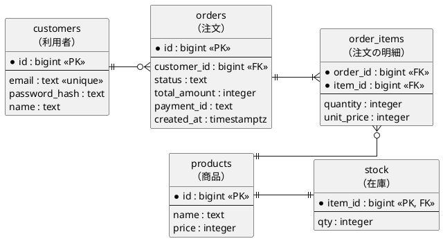

# 8 横断的な関心事

複数の構成要素にまたがる決まりを書く。5章の各構成要素は、ここに書いた決まりに従う。

## 8.1 認証と認可

| 項目 | 決まり |
| --- | --- |
| [[利用者]]の認証 | メールアドレスとパスワード。パスワードは、bcrypt（コスト12）で、ハッシュ化して保存する。平文では保存しない |
| [[運用担当]]の認証 | 利用者とは別のログイン画面。パスワードに加えて、ワンタイムパスワード（二要素認証）を必須にする |
| 認証後の状態 | APIは、状態を持たない（ADR-6）。そのため、署名付きのアクセストークン（JWT）を使う。有効期間は15分 |
| 再ログインの省略 | リフレッシュトークン（有効期間7日）を、データベースに保存する。ログアウトや、パスワード変更のときに、無効にする |
| 認可 | ロールは、`CUSTOMER`と`OPERATOR`の2つ。`CUSTOMER`は、自分の注文だけを操作できる。商品・在庫の管理と、[[出荷指示]]は、`OPERATOR`だけが行える |
| ログインの失敗 | 同じアカウントで、10分間に5回失敗したら、15分間ロックする |

関連: Q4

## 8.2 ログと監視用の情報

| 項目 | 決まり |
| --- | --- |
| 形式 | 1行1件のJSON。時刻・レベル・相関ID・メッセージを、必ず含める |
| 相関ID | Webアプリからの1回の呼び出しごとに付け、APIの内部と、[[決済代行サービス]]への呼び出しのログまで、同じIDで追えるようにする |
| 個人情報 | 氏名・住所・メールアドレス・パスワード・トークンは、ログに出さない。注文IDと、利用者IDだけを出す |
| カード番号 | カード番号は、自社のシステムに届かない（ADR-4）。万一、ログに混ざったときのため、カード番号の形式（13〜19桁の数字）を、出力の前にマスクする。マスクの漏れは、毎日の自動検査で見つける（S4） |
| 保持期間 | 30日。超えたものは、自動で削除する |

関連: Q2・Q4、S4

<!-- pagebreak -->

## 8.3 エラー処理と、外部呼び出し

| 呼び出し先 | タイムアウト | 再試行 | 失敗したときの扱い |
| --- | --- | --- | --- |
| 決済代行サービス | 3秒 | しない（ADR-2） | 注文を失敗として扱い、在庫を戻す |
| メール配信サービス | 5秒 | 5分間隔で、最大3回 | 3回失敗したら、運用担当への通知に回す。注文の確定には、影響させない |
| データベース | 2秒 | 接続の失敗だけ、1回 | 失敗したら、`503`を返す |

- メールの送信は、注文の確定とは別に行う。注文の確定の応答は、メールの送信を待たない（Q1）。
- APIが返すエラーは、決まった形（エラーコード・メッセージ・相関ID）のJSONで返す。内部の例外の内容（スタックトレースなど）は、利用者に返さない。

関連: Q1・Q2、ADR-2

## 8.4 設定と秘密情報

- 設定は、環境ごとの設定ファイルと、環境変数で与える。
- データベースのパスワード、決済代行サービスのキーなどの秘密情報は、クラウドのシークレット管理に置く。ソースコードと、設定ファイルには、置かない（C5のレビューで確認する）。
- 本番の秘密情報を見られるのは、運用担当だけ。

関連: Q4

<!-- pagebreak -->

## 8.5 データ構造

主なデータと、その関係を示す。

| 表 | 決まり |
| --- | --- |
| `orders` | `status`は、`PENDING`・`CONFIRMED`・`CANCELLED`のどれか。決済のトークンは保存しない。保存するのは、[[決済ID]]だけ。注文は、会計上の理由で、7年間保存する |
| `order_items` | 注文時の単価を、`unit_price`に保存する。商品の価格が後で変わっても、過去の注文の金額は、変わらない |
| `stock` | `qty`は、0以上。更新は、ADR-3の条件付き更新だけで行う |
| `customers` | 退会したら、氏名・メールアドレスを消し、注文は、利用者IDだけを残して保存する（個人を特定できなくする） |

関連: Q4、ADR-3
