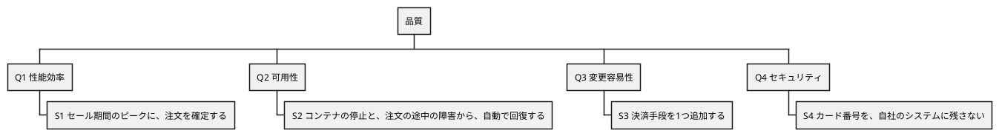

# 10 品質要求

1.5の品質目標を、測れる形に直す。評価のシナリオごとに、目標値と、測り方を書く。

## 10.1 品質ツリー

<!-- pagebreak -->

## 10.2 評価のシナリオ

| ID | 品質 | 状況（刺激） | 期待する応答 | 目標値 | 測り方 |
| --- | --- | --- | --- | --- | --- |
| S1 | Q1 性能効率 | [[セール期間]]のピーク（1分に30件の注文、同時閲覧500人）に、[[利用者]]が注文を確定する | 注文を確定し、完了の画面を返す | 決済が正常に応答するとき、95パーセンタイルで2秒以内。決済が3秒で打ち切られたときは、3.5秒以内に失敗を返し、在庫を戻す | 本番と同じ構成の試験環境で、ピークの負荷を10分間かけ、応答時間を記録する。リリースの前に、毎回行う |
| S2 | Q2 可用性 | 稼働中のAPIのコンテナが、1台停止する | 残りの台で注文を受け付け続け、停止したコンテナは、自動で置き換えられる | 注文の取りこぼしは0件。置き換えは5分以内。月間の稼働率は99.9%以上（停止は月に43分以内） | 試験環境で、コンテナを意図的に停止し、注文の受付と置き換えの時間を確かめる。四半期に1回行う。稼働率は、外形監視で、毎月集計する |
| S2 | Q2 可用性 | 注文の処理の途中で、APIが停止する | 復旧後に、未確定の注文を取り消し、引き当てた在庫を戻す | 未確定の注文は、30分以内に取り消す。在庫の不整合は、0件 | 試験環境で、注文の途中でAPIを停止し、復旧後の注文と在庫の状態を検査する。リリースの前に、毎回行う |
| S3 | Q3 変更容易性 | 事業責任者から、新しい決済手段（コード決済）の追加を依頼される | `PaymentGateway`の実装を追加し、他の部品は、変えない | 開発者1人で、5人日以内。変更するのは、決済クライアントの実装クラスと、設定だけ（他の部品の変更は0件） | 追加の作業で、変更したファイルの一覧と、かかった工数を記録する。追加のたびに、設計に反映する |
| S4 | Q4 セキュリティ | 利用者が、カード番号を入力して、決済する | カード番号は、[[決済代行サービス]]の画面で入力され、自社には、トークンだけが届く | API・データベース・ログに、カード番号の形式の値が残る件数は0件 | ログとデータベースを、カード番号の形式で自動検査する。毎日、実行する。リリースの前にも、毎回行う |

<!-- pagebreak -->

## 10.3 評価のシナリオを決めた理由

- S1の目標値（2秒）は、1.5のQ1に対応し、決済の[[打切り]]時間（3秒）より短い。決済が正常に応答するときの、注文確定の応答時間とする。打ち切られたときは、3秒に、後処理の時間を足した、3.5秒を上限にする。
- S2の目標値（稼働率99.9%）は、[[運用担当]]が1人で、夜間・休日に人が対応しない（OC4）前提で、自動回復だけで、達成できる値として決めた。さらに高い値（99.99%）は、複数のリージョンへの配置が要り、月額費用の上限（OC2）を超えるため、採らない。
- S3の目標値（5人日）は、決済代行サービスの仕様変更が、3か月前に通知される（OC5）ことに対し、十分に余裕がある値とした。
